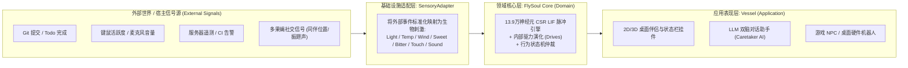

# 果蝇全脑行为仿真边界、社会性复现与“数字灵魂（FlySoul）”工程架构
# Drosophila Behavior Simulation Boundaries, Sociality & "FlySoul" Architecture

> 记录日期：2026-10-17  
> 本文档汇总了关于果蝇全脑连接组（Connectome）工程仿真能力边界、现有里程碑项目对比、果蝇社会性（Social Behaviors）复现方案，以及将果蝇大脑抽象为可插拔“生物灵魂内核（FlySoul Core）”赋能生产力与娱乐系统的架构设计。

---

## 一、 现有果蝇大脑数据能否在工程上仿真出“所有行为”？

**核心结论：不能。**

虽然人类已经获取了果蝇成年全脑的完整连接组（如 **FlyWire FAFB v783** 的 139,255 个神经元与约 5000 万个突触），并且在工程上已能仿真出**部分特定行为**（行走、梳理、逃跑反射、嗅觉趋向等），但距离复现“所有果蝇行为”仍存在以下 **5 大核心瓶颈**：

1. **全脑 $\neq$ 全神经系统（脑-体耦合与外周缺失）**
   * FlyWire 仅包含头部大脑，而控制六足行走、双翅飞行的底层微电路位于**腹神经索（VNC，果蝇的“脊髓”）**。虽然已有独立的 VNC 图谱（如 FANC/MANC），但它们来自不同个体，跨颈部数千条下行/上行神经纤维的精确工程对齐仍处于早期阶段。
   * 真实行为高度依赖**本体感觉（Proprioception）**与物理身体（腿部刚毛、翅膀平衡棒、肠道状态）的实时力学反馈。
2. **突触动态生理参数未知（缺少“元器件规格”）**
   * 电子显微镜（EM）只能提供静态连接拓扑、突触数量及 AI 预测的神经递质类型（准确率约 80%~90%），无法直接测出突触的**具体电导强度、时间常数、短期可塑性（突触疲劳/增强）**以及树突上的**离子通道分布**。
   * **电突触（间隙连接，Gap Junctions）**在现有电镜分辨率下几乎不可见，而它对超快逃跑反射至关重要。
3. **神经调质与“无线广播系统”缺失（有线图看不见 Wi-Fi）**
   * 饥饿、睡眠、求偶、攻击、产卵等长周期状态转换，受控于**多巴胺、章鱼胺、五羟色胺、神经肽（Neuropeptides）与激素**。这些物质往往通过细胞外液弥散（Volume Transmission，“无线广播”），动态改写整片神经网络的兴奋度，静态连接组不包含这层信息。
4. **学习与突触可塑性（静态快照 vs. 动态记忆）**
   * 电镜切片是果蝇死亡固定那一刻的静态快照。要在工程中复现蕈形体（Mushroom Body）的联想学习能力，必须人为引入可塑性规则（如 STDP 或多巴胺门控学习律）。
5. **工程上的维度灾难（参数拟合问题）**
   * 14 万神经元和数千万突触意味着数千万个未知生物物理参数。目前工程界通常采用大幅简化（如 LIF 点神经元模型，假设突触权重与突触数量成正比）或利用深度学习/强化学习反向拟合行为数据。

---

## 二、 目前工程上能做出的行为丰富度与代表性项目

如果将果蝇行为丰富度分为 **L1 ~ L4** 四个等级，目前全球工程界已经扎实走到了 **L2.5 阶段**：

| 行为层级 | 目前能否仿真？ | 具体表现举例 | 工程实现方式 |
| :--- | :---: | :--- | :--- |
| **L1：单动作与感官反射** | ✅ **完全可以** | 遇糖伸喙喝水（PER）、遇苦味抑制、触角受激清理、紧急起跳 | 纯连接组脉冲神经网络（SNN/LIF）直接涌现 |
| **L2：连续运动与多感官导航** | ✅ **成熟** | 崎岖地形自适应三足步态、逆风气味羽流寻源、视觉避障与追逐目标 | 连接组约束 + 强化学习 (RL) + 3D 物理引擎 |
| **L3：单任务学习与空间导航** | 🟡 **局部实现** | 中央复合体（CX）环形吸引子方向指南针、蕈形体（MB）气味奖惩学习、多行为赢者通吃仲裁 | 局部脑区建模 + 手写可塑性/调质规则 |
| **L4：长周期内稳态与复杂社交** | ❌ **尚不能端到端涌现** | 自发困倦睡眠、饥饿觅食切换、完整求偶唱歌与领地打架切换、产卵选址 | 缺乏神经调质/激素数据，需引入显式的工程内驱力状态机 |

### 全球 5 大代表性工程项目对比（含当前 `FlyBrain` 仓库）

| 项目名称 | 团队 / 时间 | 神经元规模 | 身体 / 物理引擎 | 核心工程成就与生态位 |
| :--- | :--- | :--- | :--- | :--- |
| **`Drosophila_brain_model`** | Shiu et al. (UC Berkeley, *Nature* 2024) | 139,255 (全脑) | 无身体（纯神经元激活预测） | 首个在 `Brian2`/`PyTorch` 中跑通的 FlyWire 全脑 LIF 模型，免训练直接以 90%+ 准确率预测进食与梳理运动神经元激活。 |
| **`NeuroMechFly v2` / `FlyGym`** | EPFL Ramdya Lab (*Nature Methods* 2024) | 局部脑区 / VNC / RL | 3D 刚体力学 (MuJoCo) | 最成熟的 3D 机械果蝇开源框架，支持复眼视觉、触角嗅觉、腿部力反馈闭环，实现复杂地形行走、气味寻源与求偶追逐。 |
| **`Virtual Fruit Fly`** | Google DeepMind & Janelia (2024–2025) | 深度神经网络控制器 | 3D 全身 + 空气动力学 (MuJoCo) | 首次在物理引擎中同时统一了**地面六足行走、梳理与空中拍翅悬停、急转弯飞行（Saccade）**。 |
| **`flyvis`** | Janelia Turaga Lab (*Nature* 2024) | ~45,000 (视觉系统) | 视觉渲染输入 | 将连接组直接映射为深度网络固定拓扑，通过完成视觉任务反向拟合出未知的电生理参数，精准复现活体单细胞反应。 |
| **当前仓库 (`FlyBrain`)** | Forked from `snedea/flybrain` | **139,255 (全脑)** | **2D 交互沙盒 (Browser)** | **零依赖、浏览器端 Web Worker 实时运行 13.9 万神经元 CSR 稀疏矩阵 LIF 仿真 + 5 大内驱力（Drives）与 AI Caretaker 闭环。** |

---

## 三、 工程上复现“果蝇社会性（Sociality）”的可行性与方案

**结论：完全可行。** 果蝇虽然不是蚂蚁/蜜蜂那样的“真社会性（Eusocial）”昆虫，但拥有刻板且神经环路极其清晰的**群体与社交行为**。

### 1. 可复现的 4 类核心果蝇社交行为
1. **求偶与唱“求偶歌”（Courtship & Singing）**：视觉小目标检测（`LC10a`）+ 费洛蒙 $\rightarrow$ 激活中央脑 **`P1 / pC1` 神经元簇** $\rightarrow$ 持续追逐同伴，并**单侧激活翅膀运动神经元**（`MN_WING_L` 或 `MN_WING_R`）振动唱求偶歌。
2. **领地争夺与攻击（Territorial Aggression）**：两只果蝇在食物（`food`）旁相遇 $\rightarrow$ 激活 **`pC1` / `AIP` / `Tk` 神经元**（与求偶环路相互抑制）$\rightarrow$ 对峙、冲撞（Lunging）驱赶对方。
3. **社交聚集与安全间距（Aggregation & Social Spacing）**：通过聚集信息素（如 *cVA*）在食物点相互吸引群聚觅食；但在静止休息（`rest`）时通过视觉和机械触碰保持约 1~2 个身位的社交间距。
4. **恐慌的群体传染（Social Contagion of Fear）**：一只果蝇受惊起飞（`startle` / `fly`），其拍翅气流声与移动黑影通过周围果蝇的**江氏器（`MECH_JO`）**和**运动视觉（`VIS_LPTC`）**瞬间引发群体连锁惊飞。

### 2. 基于 `FlyBrain` 现有代码的工程改造路径
当前仓库的 `data/neuron_meta.json` 和 `js/connectome.js` 已经具备了 **70% 的社交基础设施**（如 `MECH_JO` 听觉 879 个神经元、`VIS_LPTC` 运动视觉 1,907 个神经元、`MECH_BRISTLE` 触觉 1,927 个神经元、以及独立的左右翅 `MN_WING_L/R`）。

要在工程上落地多果蝇社会性，只需完成以下 3 步演进：
1. **职责边界重构（Multi-Agent Arena）**：
   * 将当前 `js/fly-logic.js` 和 `js/connectome.js` 中的全局单例 `fly` / `BRAIN` 封装为独立的 `FlyAgent` 实例，由上层 `Arena` 对象统一管理多果蝇坐标、视线夹角、碰撞检测与信息素场。
2. **多脑并发调度（Worker 性能方案）**：
   * **混合模式（推荐）**：主视角果蝇运行 13.9 万神经元 Web Worker (`js/sim-worker.js`)，其余同伴果蝇运行 70 节点轻量级功能连接组 (`js/connectome.js`)。
   * **全脑批处理模式**：在 `sim-worker.js` 中共享同一份 270 万条边的 CSR 突触拓扑矩阵，将电压状态向量扩维为 `Float32Array(K * N)`，单次遍历同时更新 $K$ 只果蝇的全脑脉冲。
3. **新增社交感官、驱力与状态机分支**：
   * **感官层 (`BRAIN.stimulate`)**：增加 `peerNearby`（同伴视觉）、`peerSong`（求偶歌听觉，刺激 `MECH_JO`）、`pheromone`（聚集/性别气味）。
   * **驱力与中枢 (`BRAIN.drives`)**：新增 `social` 驱力，并在 `GENERIC_CENTRAL` 中划分出 `CENTRAL_P1`（求偶）与 `CENTRAL_AIP`（攻击）相互抑制节点。
   * **行为层 (`evaluateBehaviorEntry`)**：新增 `court`（追逐+单侧振翅）、`lunge`（食物争抢冲撞）、`aggregate`（温和靠拢）状态。

---

## 四、 将果蝇大脑作为“灵魂（FlySoul Core）”装入外部系统的工程构想

大语言模型（LLM）是“纯理性的缸中之脑”——没有外部 Prompt 时完全静止，没有内在时间感、饥饿感或自发冲动。而 **13.9 万神经元的果蝇连接组 + 内驱力系统** 恰恰是一个**持续跳动的“自主生物灵魂（Autonomous Bio-Core）”**。

依托项目中现有的 WebSocket 桥接机制（`js/caretaker-bridge.js`），可以将果蝇脑剥离为通用的“灵魂卡带”，赋能以下 **4 大生产力与娱乐场景**：

### 1. 四大应用场景

#### 场景 A：【生产力 × 陪伴】“共生型”番茄钟与心流伴侣 (Bio-Rhythm Focus Companion)
* **感官绑定**：
  * 完成一个 Todo / 提交一次 `git commit` $\rightarrow$ 投喂食物（激活 `OLF_ORN_FOOD` + `GUS_GRN_SWEET`），点亮果蝇脑内的多巴胺奖赏神经元（`MB_DAN_REW`）。
  * 连续敲击键盘写代码的时间 $\rightarrow$ 同步积累果蝇的运动消耗与 `fatigue`（疲劳度）。
* **核心价值**：当你连续高强度工作 50 分钟后，屏幕角落的果蝇灵魂因 `fatigue` 突破阈值自动进入 `rest`（打盹），用真实的生物节律温和提醒你休息；每次代码提交都能收获 14 万神经元真实放电的生物级正反馈。

#### 场景 B：【生产力 × 监控】矿井里的“赛博金丝雀” (System Telemetry Bio-Sensor)
* **感官绑定**：将果蝇感官接入服务器监控、CI/CD 状态或金融行情流：
  * CPU/内存负载飙升 $\rightarrow$ 环境温度升高（激活 `THERMO_WARM`，果蝇变得焦躁活跃）。
  * 线上 Error Log 激增或构建失败 $\rightarrow$ 危险气味或痛觉刺激（激活 `OLF_ORN_DANGER` / `NOCI`）。
  * 服务平稳运行 $\rightarrow$ 适宜光线与规律食物。
* **核心价值**：无需分心紧盯枯燥的监控仪表盘。眼角余光看到果蝇在悠闲 `explore`（散步）或 `groom`（理毛）即代表系统健康；一旦它突然高频 `startle`（惊跳）乱飞，即可凭生物直觉第一时间察觉线上异常。

#### 场景 C：【娱乐 × 数字生命】“果蝇本能 + LLM 语言”的双脑桌面精灵 (Subconscious Engine for AI Agents)
* **双脑协同架构**：
  * **潜意识层（果蝇全脑 LIF）**：7×24 小时在后台实时演化 `hunger`、`fear`、`curiosity`、`fatigue` 与神经脉冲。
  * **语言中枢层（LLM）**：仅当果蝇脑的某个内驱力突破阈值（如 `curiosity` 极高想要探索，或 `hunger` 极高想要讨食）时，才唤醒 LLM 主动找用户搭话，或自主抓取一篇外部资讯作为“食物”消化；当 `fatigue` 满载时，AI 会表现出困倦并拒绝长篇大论。
* **核心价值**：彻底告别靠 Prompt 硬编情绪的“塑料感 AI 桌宠”，赋予 Agent 真正不可完全预测的生理节律与生命感。

#### 场景 D：【娱乐 × 游戏/硬件】可插拔的“灵魂卡带” (Soul Cartridge for Games & Hardware)
* 将 `sim-worker.js` 封装为独立 SDK，装入 Unity/Godot 游戏作为虫群/Boss 的真实神经内核，或通过蓝牙/Wi-Fi 接入桌面微型机器人（ESP32 小车：光敏电阻接 `VIS_R1R6`、麦克风接 `MECH_JO`、碰撞开关接 `MECH_BRISTLE`、双轮电机接 `MN_LEG_L/R`），让 14 万神经元的果蝇灵魂在真实办公桌上觅光避障。

---

### 2. 三层解耦架构设计 (Responsibility Boundaries)

遵循“创建对象即定义职责边界”的架构原则，可将系统划分为清晰的三个层次：

* **`FlySoul Core`（领域层 Domain）**：承担最核心的生物计算职责。只接收标准化的生物感官刺激，专注完成 13.9 万神经元脉冲传播与内驱力更新，并向外报告当前的动作意图与情绪状态，对外部宿主环境完全无感知。
* **`SensoryAdapter`（基础设施层 Infrastructure）**：负责把五花八门的外部事件（Git 提交、CPU 负载、鼠标点击、或是另一只果蝇的求偶歌声）翻译为 `FlySoul Core` 的感官输入协议。
* **`Vessel`（应用层 Application）**：负责将 `FlySoul Core` 输出的运动神经元累积量与内驱力状态，渲染为具体的视觉形象、生产力提醒或 LLM 对话行为。
