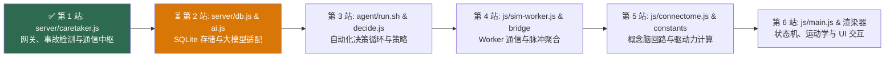

# FlyBrain 源码精读学习计划 (Codebase Deep-Dive Plan)

本学习计划是继《感觉神经回路与行为映射学习手册》之后的**第二阶段（工程源码级精读）**。
核心目标是以**“职责边界划分（Responsibility Boundary）”**与**“像读故事一样理解任务编排（Story-driven Orchestration）”**的视角，自底向上、从后端到前端逐个文件吃透 FlyBrain 的工程实现。

---

## 整体精读路线图（共 6 站）

| 站次 | 目标文件 | 所属架构层 | 核心职责边界 | 当前进度 |
| :---: | :--- | :--- | :--- | :---: |
| **第 1 站** | [`server/caretaker.js`](../server/caretaker.js) | 应用网关层 (Application / Gateway) | 串联浏览器 WebSocket、`stdin` 控制流、`db.js` 存储与 `ai.js` 问答的总调度中枢 | ✅ 已完成 |
| **第 2 站** | [`server/db.js`](../server/db.js) & [`server/ai.js`](../server/ai.js) | 基础设施层 (Infrastructure) | SQLite 表结构设计、每日照料评分算法、多模型端点归一化与响应解析 | ⏳ 下一站 |
| **第 3 站** | [`agent/run.sh`](../agent/run.sh), [`agent/decide.js`](../agent/decide.js), `*-policy.md` | 自动化代理层 (Agent / Policy) | 命名管道 (FIFO) 守护循环、恐惧退避 (Fear Backoff) 机制、LLM 决策与输出清洗 | 待开始 |
| **第 4 站** | [`js/sim-worker.js`](../js/sim-worker.js) & [`js/brain-worker-bridge.js`](../js/brain-worker-bridge.js) | 仿真引擎与桥接层 (Simulation & Bridge) | 13.9 万神经元 CSR 矩阵计算、Neuropil 门控休眠、真实脉冲向概念脑区的聚合映射 | 待开始 |
| **第 5 站** | [`js/connectome.js`](../js/connectome.js) & [`js/constants.js`](../js/constants.js) | 领域模型层 (Domain Model) | ~60 个概念神经群的突触传播、双缓冲状态切换、5 大内驱力更新与电机累加器 | 待开始 |
| **第 6 站** | [`js/main.js`](../js/main.js), [`js/neuro-renderer.js`](../js/neuro-renderer.js), [`js/brain3d.js`](../js/brain3d.js) | 表现与物理交互层 (Presentation & Physics) | 行为状态机仲裁、六足三足步态绘制、WebGL2 粒子渲染、左侧边栏 (Feed/Chat/Calendar) | 待开始 |

---

## 第 1 站笔记：[`server/caretaker.js`](../server/caretaker.js)（全长 415 行）

### 1. 角色定位与职责边界
`caretaker.js` 是后端的**总调度室（Hub / Gateway）**。它不直接编写复杂的 SQL 语句，也不直接处理底层环境变量解析，而是负责协调四个外部对象：
1. **浏览器前端**：通过 WebSocket 接收高频状态上报、下发控制指令；通过 HTTP 提供静态资源与报表 API。
2. **自动化 Agent (`run.sh`)**：通过 `stdin` 接收 JSON 控制命令，通过 `stdout` 输出执行回执与事件流。
3. **数据库模块 (`db.js`)**：委托其存储观测快照、动作记录、事故告警与聊天历史。
4. **AI 客户端模块 (`ai.js`)**：委托其调用大模型接口回答用户在侧边栏的提问。

### 2. 代码章节拆解（按故事线演进）

* **章节 1：初始化与核心状态变量（[第 1–22 行](../server/caretaker.js#L1-L22)）**
  * `lastState`：缓存最新一帧果蝇状态，供 `GET /state` 零延迟返回。
  * `lastObservationTime` & `OBSERVATION_INTERVAL_MS = 10000`：节流阀，限制每 10 秒向 SQLite 写入一次观测记录。
  * `lastActionTime`、`lastActionType`、`preFearLevel`：事故追责快照三元组，记录每次动作执行瞬间的恐惧基线。
  * `VALID_ACTIONS`：指令白名单 `['place_food', 'set_light', 'set_temp', 'touch', 'blow_wind', 'clear_food']`。

* **章节 2：感知 $\rightarrow$ 督察 $\rightarrow$ 控制的三大核心函数（[第 38–115 行](../server/caretaker.js#L38-L115)）**
  1. `handleStateMessage(data)`（[第 69–85 行](../server/caretaker.js#L69-L85)）：解析浏览器发来的状态 $\rightarrow$ 更新 `lastState` $\rightarrow$ 满 10 秒则调 `insertObservation` 落库 $\rightarrow$ 打印 `stdout` $\rightarrow$ 触发 `detectIncidents()`。
  2. `detectIncidents(state)`（[第 38–67 行](../server/caretaker.js#L38-L67)）：
     * **`scared_the_fly`（高危 `high`）**：动作发生后 5 秒内，`fear - preFearLevel > 0.2`，立刻落库并通过 WebSocket 广播告警，随后将 `lastActionTime` 置 `0` 避免重复触发。
     * **`forgot_to_feed`（中危 `medium`）**：当 `hunger > 0.9 && foodCount === 0` 时触发，带有 60 秒冷却期（查询上次同类事故时间戳）。
  3. `handleStdinCommand(line)`（[第 87–115 行](../server/caretaker.js#L87-L115)）：校验 JSON 与动作白名单 $\rightarrow$ 拍下 `preFearLevel` 快照 $\rightarrow$ 调 `insertAction` 落库并广播给前端活动流 $\rightarrow$ 通过 WebSocket 发送 `{ type: 'command', ... }` 驱动浏览器执行动作。

* **章节 3：AI 聊天上下文构建与请求处理（[第 117–184 行](../server/caretaker.js#L117-L184)）**
  * `buildChatContext()`：提取最近 20 条观测、20 条动作、20 条事故，拼接为带时间戳与精确数值的 Markdown 文本。
  * `handleChatRequest(userMessage, viewContext)`：将 `agent/chat-policy.md` + 遥测上下文 + 用户当前视图 `viewContext` 组装为 `systemPrompt`，附带最近 20 条对话历史调用 `anthropic.messages.create()`，并将问答双双落库。

* **章节 4：静态文件服务与安全防护（[第 186–239 行](../server/caretaker.js#L186-L239)）**
  * `serveStatic(req, res)`：托管项目根目录静态资源，通过剥离 `..` 并校验 `filePath.startsWith(STATIC_ROOT)` 防止目录穿越攻击（Path Traversal）。

* **章节 5 & 6：HTTP 路由表、WebSocket 生命周期与定时任务（[第 241–415 行](../server/caretaker.js#L241-L415)）**
  * **HTTP 路由**：`GET /state`、`POST /chat`、`GET /chat/history`、`GET /analytics/summary`、`GET /analytics/hunger-timeline`、`GET /calendar/scores`、`GET /calendar/day-activity`、`GET /activity/recent`。
  * **定时评分**：每 5 分钟调用 `caretakerDb.computeDailyScore(today)` 更新当日照料评分。
  * **优雅退出**：监听 `SIGINT` / `SIGTERM`，关闭数据库连接与 WebSocket Server。

### 3. 架构审视与潜在改进点
* **单 WebSocket 连接覆盖问题**：`var browserSocket = null;`（第 21、376 行）假设同一时刻只有一个浏览器标签页连接。若打开多个标签页，后连接的标签页会覆盖 `browserSocket`，且任一标签页关闭都会导致 `browserSocket = null`，使其他存留标签页失去指令接收能力（若需支持多客户端，可改为遍历 `wss.clients` 集合）。
