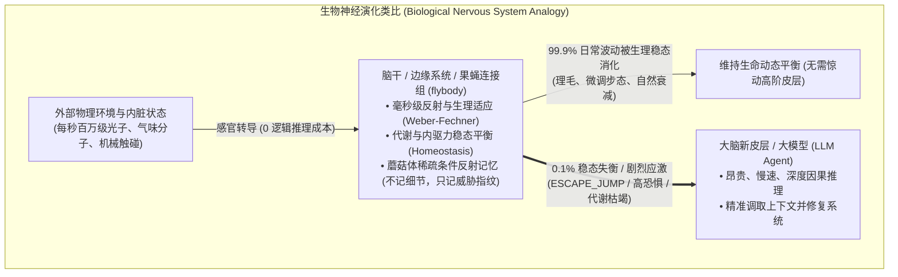
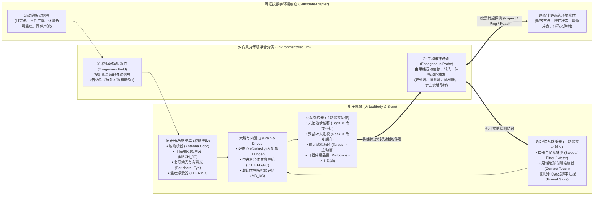
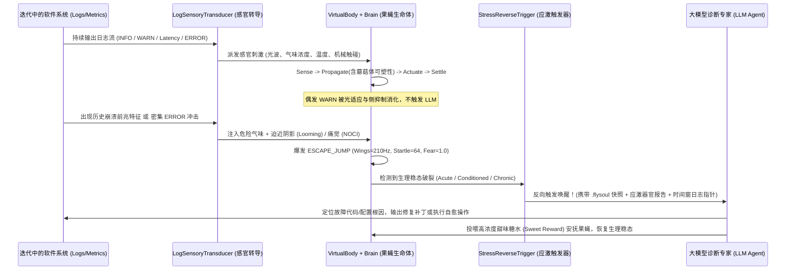
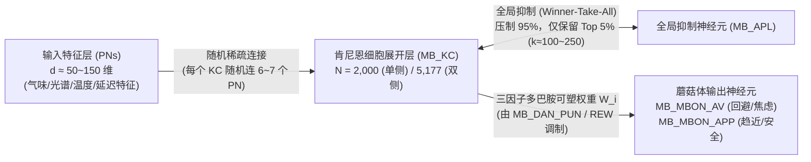

# 果蝇电子社会（Fly Digital Society）与软件日志稳态感知、应激反向触发大模型架构设计
# Fly Digital Society: Homeostatic Log Sensing, Mushroom Body Memory & Stress-Driven LLM Trigger Architecture

> 记录日期：2026-11-06  
> 前置文档：[《Go 语言果蝇虚拟身体（`flybody`）与无原点三维去中心化空间架构设计》](./virtual-body-and-decentralized-3d-world.md)  
> 核心愿景：构建一个富有想象力的**果蝇电子社会（Fly Digital Society）**；让每一只具备“大脑 + 虚拟身体”动态平衡机制的果蝇个体或群体，去**感应、分析、记住**正在迭代的软件系统运行信号（日志/指标），将系统的负面状态转化为果蝇的生理刺激，并在果蝇产生**生理应激（Stress Response）**时**反向触发大模型（LLM）介入工作**。

---

## 一、 核心哲思：为什么不直接把错误日志喂给 AI，而要先经过一只果蝇？

乍看之下，“软件日志 $\rightarrow$ 果蝇感官与大脑 $\rightarrow$ 果蝇应激 $\rightarrow$ 反向触发大模型”似乎比“软件日志 $\rightarrow$ 直接喂给大模型”多了一层。然而从**控制论（Cybernetics）**、**计算神经科学（皮层下门控机制）**与**生物免疫系统（Biological Immunity）**的视角来看，这一层恰恰是解决大模型时代“算力破产”与“上下文噪音淹没”的关键缺失环：

### 1. 皮层下稳态门控（Subcortical Homeostatic Gating）：保护昂贵的“新皮层”
在生物演化中，如果负责深度思考的大脑新皮层（对应 **LLM**）必须亲自阅读每一根体毛的弯曲、每一个视网膜细胞的放电（对应软件系统每秒成千上万行的 `INFO/WARN/ERROR` 日志），生物体会在几秒内因能量耗竭而死。
* **果蝇（`flybody`）的角色**：它是**零 Token 成本、单步耗时 $<1\text{ms}$ 的皮层下自主神经稳态系统**。
* **动态平衡过滤噪音**：
  * 软件迭代过程中的偶发毛刺（单次网络抖动、偶发重试），打在果蝇身上只会引起轻微的刚毛偏转（[`BristleArray`](../flybody/internal/domain/organ/neck_bristle.go)）或嗅觉旁路抑制（[`OLF_LN`](../flybody/internal/domain/brain/weights.go)）。果蝇通过前足理毛（`GROOM_CLEAN`）或膜电位自然泄漏即可恢复平衡，**完全不需要消耗大模型算力**。
  * 只有当负面信号真正冲破了果蝇的生理稳态边界（引发惊跳逃逸 `ESCAPE_JUMP`、恐惧爆发或能量衰竭）时，果蝇才会作为“生物保险丝”**反向唤醒大模型**。

### 2. “记住特征，但不记细节” —— 蘑菇体（Mushroom Body）的直觉记忆
**果蝇绝对不应该像数据库一样存储日志的文本细节**。真实果蝇是如何在不记住化学分子式的情况下“记住某种气味代表危险”的？答案在果蝇大脑的**蘑菇体（Mushroom Body，`MB_KC` $\rightarrow$ `MB_MBON`）**：
1. **稀疏指纹投影（Sparse Odor Coding）**：
   * 外部软件日志的报错模式、模块来源与频率特征，被转导为不同比例的**气味受体组合**与**光谱波长**，投射到肯尼恩细胞（`MB_KC`）形成稀疏激活指纹。
2. **多巴胺奖惩可塑性（Dopaminergic Synaptic Plasticity）**：
   * 当某组看似温和的“前兆日志特征”（比如某模块延迟微升 + 特定 Warning 气味）出现后，系统紧接着发生了崩溃/OOM（相当于果蝇遭受了剧烈的痛觉刺激 [`NOCI`](../flybody/internal/domain/brain/weights.go) 或苦味毒素 [`GUS_GRN_BITTER`](../flybody/internal/domain/brain/weights.go)，激活惩罚性多巴胺神经元 `MB_DAN_PUN`）。
   * 此时，该前兆气味对应的 `MB_KC` $\rightarrow$ `MB_MBON_AV`（厌恶/回避输出神经元）的**突触连接权重会被持久化强化**（保存在 `.flysoul.json` 中）。
3. **跨周期前兆预警（Pre-fault Conditioning）**：
   * 下次系统迭代运行中，哪怕致命的 `ERROR/Panic` 还没发生，只要那股“前兆气味”再次出现，果蝇大脑中已被强化的 `MB_MBON_AV` 就会立即触发 `LH_AV` 与 `DRIVE_FEAR`，让果蝇提前进入**焦虑/逃逸应激态**，从而**在故障真正爆炸前提前叫醒大模型**！
   * 整个过程中，果蝇没有存下一行日志字符串，**它的突触权重矩阵与器官适应度本身就是对软件系统脾气秉性的“肉身记忆”**。

### 3. 捕捉“温水煮青蛙”式的慢性劣化（Metabolic Allostasis）
静态阈值告警（如 `5分钟内 ERROR > 50`）对缓慢恶化的系统（如缓慢内存泄漏、线程池轻微阻塞、偶发超时率从 0.1% 爬升到 1.5%）几乎失明。
* 在果蝇虚拟身体中，[`MetabolicTissue`](../flybody/internal/domain/metabolism/metabolism.go) 维护着真实的**糖原储备（`GlycogenReserve`）**、**ATP 水平**与**五大内驱力（`Hunger`, `Fear`, `Fatigue`, `Curiosity`, `Groom`）**。
* 持续的低烈度负面日志就像不断消耗果蝇体力的逆风（`MECH_JO`）和落灰（`MECH_BRISTLE`），同时阻碍正常业务请求的糖分摄入（`Proboscis`）。久而久之，果蝇会陷入**低血糖（Starvation）+ 极度疲劳（Exhaustion）**的“亚健康衰竭态”，从而触发**慢性体检型 LLM 唤醒**。

---

## 二、 正反思辨（Devil's Advocate）：既然唤醒后大模型依然要读日志，果蝇与简单 `if (ERROR)` 规则到底差在哪？

在架构推演中，我们必须直面一个最尖锐的**反驳（Counter-argument）**：
> **“既然果蝇应激唤醒大模型后，大模型依然需要去读取原始日志来定位问题——那它难道不是读取了所有相关日志吗？如果只是为了触发大模型去读日志，写一行 `if (error_count > 10)` 的脚本触发不就够了吗？为什么非要中间隔一只果蝇？”**

顺着这个反驳往深处推演，我们可以把果蝇（及果蝇社会）的真实架构边界彻底厘清：**如果仅仅是为了捕获显式的 `ERROR` 关键字，用果蝇确实是杀鸡用牛刀；果蝇真正的不可替代性，在于解决“何时该唤醒”以及“在大海捞针的分布式日志里，哪几十行才算相关日志”这两个传统规则与全量 LLM 都无能为力的盲区。**

### 1. 痛觉神经与核磁共振的类比：从“7×24 全量盲读”到“0.1% 靶向切片”
果蝇**不是为了替代大模型“读日志”**，正如人体的痛觉神经（`NOCI`）不能替代医生的眼睛去看核磁共振片子一样：
* **全量直接喂给 LLM**：相当于让人体 24 小时躺在核磁共振机里，让医生盯着全身每秒的细胞活动——算力预算当场破产，且 99.9% 的信息是无意义的日常代谢噪音。
* **果蝇应激门控后再读日志**：平时 99.9% 的时间医生都在休息（**0 Token 消耗**），由果蝇的自主神经与代谢系统扛住日常风浪；只有当果蝇突然感到**“右前足剧痛”或“左触角闻到焦糊味”**并爆发应激时，才把医生叫醒，而且告诉医生：**“不用做全身扫描，直接只拍右下腹过去 3 分钟的切片！”**

### 2. 超越静态 `if (ERROR)` 规则的三大核心能力

如果只是 `grep ERROR`，三行脚本就能搞定；但正在迭代的软件系统中，最致命往往不是显式的单行 `ERROR`，而是以下三类只有**“动态生理平衡系统”**才能感知的隐性危机：

#### ① 多维弱信号的“非线性代谢叠加”（识别温水煮青蛙）
假设系统迭代后出现了以下三条日志/指标：
* 日志 A：`INFO: request latency 380ms`（未超 500ms 告警阈值，静态规则判定正常）
* 日志 B：`WARN: cache miss, fallback to DB`（偶发警告，静态规则判定正常）
* 日志 C：`INFO: GC pause 45ms`（未报错，静态规则判定正常）

任何静态 `if (ERROR)` 规则面对这三条日志都会**完全失明**；而全量喂给 LLM 又不可能 24 小时持续监控所有 `INFO` 日志。
但在果蝇虚拟身体中，**所有器官共享同一个代谢能量池（[`MetabolicTissue`](../flybody/internal/domain/metabolism/metabolism.go)）**：
* 延迟微升使环境变暖（`THERMO_WARM`），Cache Miss 如体表落灰触发频繁理毛（`GROOM_CLEAN` 持续消耗体力），GC 停顿减少了正常业务请求的糖分补给（`Proboscis`）。
* 这三件“各自不违规”的小事在果蝇身体里叠加运行 10 分钟，**果蝇的血糖（`Glycogen`）被抽干、疲劳度（`Fatigue`）爆表**！果蝇因“代谢虚脱”反向触发大模型，从而捉住所有静态规则漏掉的系统级亚健康隐患。

#### ② 对“狼来了”高频无害噪音的自动脱敏（生理习惯化 Habituation）
软件快速迭代时，经常会出现某种**无害但高频刷屏的 `WARN` 日志**（如第三方非核心接口偶发超时、废弃配置提示）。
* **静态规则**：会反复误报，一次次把大模型叫醒去读同一堆废话日志，白白消耗 Token。
* **果蝇感官**：复眼（[`CompoundEye.Adaptation`](../flybody/internal/domain/organ/eye.go)）与触角天生具备**韦伯-费希纳生理适应（Adaptation）**。如果某种刺激反复出现，但事后并没有伴随真正的系统崩溃（没有痛觉 `NOCI` 或苦味 `GUS_GRN_BITTER` 惩罚），果蝇感受器的适应度会自动升高、降低增益——**对无害噪音产生生理免疫，不再一惊一乍地打扰大模型**。

#### ③ 帮大模型精准界定“什么是相关日志”（果蝇社会的解剖学寻血猎犬）
在一个包含 20 个微服务/模块的系统中，故障发生时过去 5 分钟可能有 **50 万行日志**。如果直接问大模型“请读取所有相关日志”，大模型根本不知道哪几百行才是“相关”的（全塞进去不仅昂贵，还会引发长上下文 *Lost in the Middle* 幻觉）。
而在**果蝇电子社会**中，**“哪只果蝇先应激 + 它的哪个器官受了什么特征刺激”**直接生成了一张**因果检索导航图（Somatotopic Retrieval Map）**：
1. **锁定第一案发时间与模块**：“驻守在 `Redis模块` 的 2 号果蝇在 `10:02:15` 最先因为高温（延迟）触发了蘑菇体焦虑”；
2. **锁定故障传播路径与错误特征**：“3 秒后，驻守在 `订单模块` 的 5 号果蝇听到 2 号的 210Hz 振翅声波，同时自己的左触角闻到了 `#409` 号危险气味（连接池耗尽），随后爆发 `ESCAPE_JUMP`”。
3. **精准切片投喂 LLM**：系统只需顺着果蝇的应激轨迹，**精准抽取出 `10:02:15` 的 `Redis` 延迟日志 + `10:02:18` 的 `订单模块 #409` 日志（总共可能只有 30 行！）**交给大模型。

### 3. 三种范式的全景对比

| 评估维度 | 范式 A：直接将日志流全量喂给 LLM | 范式 B：传统 `if (ERROR)` 静态规则触发 LLM | 范式 C：果蝇身体稳态 + 果蝇电子社会门控触发 LLM |
| :--- | :--- | :--- | :--- |
| **平时健康或轻微抖动时** | 7×24 小时持续烧 Token 读流，成本极高 | 0 消耗，但需要人工维护大量阈值规则 | **果蝇靠生理适应与代谢平衡自行消化，LLM 0 消耗** |
| **无 `ERROR` 的多维慢性劣化** | 受限于滚动窗口大小，极易漏检跨时段劣化 | **完全失明**（未触发单点阈值） | **果蝇代谢池失衡（低血糖/高疲劳累积）精准触发唤醒** |
| **无害的高频 `WARN` 刷屏** | 反复阅读重复噪音，浪费上下文 | **告警风暴**，反复误唤醒 LLM | **感官自动适应脱敏（Adaptation），自动屏蔽无害噪音** |
| **历史崩溃前兆（未报错阶段）** | 无法跨天记忆低维统计指纹 | **完全失明**（直到再次崩溃才报警） | **蘑菇体（`MB_KC`）条件反射提前产生恐惧应激，超前预警** |
| **唤醒后 LLM 需读取的日志量** | 全量盲读，大海捞针 | 不知道跨服务根因，只能拉取全量上下文 | **顺着“先应激果蝇 + 受激器官 + 气味指纹”，只切出几十行核心因果日志** |

> **一句话总结定位**：果蝇不是为了替代大模型“读日志”，果蝇是大模型的**“寻血猎犬（Bloodhound）与生物保险丝”**——它用零成本的生理稳态替大模型挡住 99% 的日常风浪，并在真正出事时，顺着气味帮大模型咬住那 1% 最致命的日志切片。

---

## 三、 具身环境耦合介质（`EnvironmentMedium` / `Digital Umwelt`）：被动场接收与主动运动探索

如果仅仅把传导系统做成单向的“日志解析器”，果蝇就会退化成一只被绑在椅子上强行灌日志的“植物蝇”，它身上的六条腿（[`HexapodLegs`](../flybody/internal/domain/organ/legs.go)）、双翅（[`WingPair`](../flybody/internal/domain/organ/wings.go)）、颈部关节（[`NeckJoint`](../flybody/internal/domain/organ/neck_bristle.go)）以及好奇心（`Curiosity`）、饥饿感（`Hunger`）全都成了摆设。

遵循生物控制论中的 **Umwelt（环世界/主观生态场）** 与 **Active Inference（主动推理）** 原理，我们将果蝇与外部数字世界之间的传导层正式定位为 **双向具身环境耦合介质（`EnvironmentMedium`）**，同时承载**被动场辐射**与**主动探索采样**两条通道：

### 1. 两大交互通道的职责划分
1. **通道 ①：被动场感知（Passive Field Radiation —— “风吹草动，引你注意”）**
   * **生理载体**：触角嗅觉（`Antenna`）、江氏器风感/听觉（`MECH_JO`）、环境温度（`THERMO`）、复眼大范围背景光与迫近黑影（`CompoundEye`）。
   * **机制**：外部系统主动推送的信号（如实时日志流、负载气压、同伴振翅）在环境中形成随距离衰减的场。果蝇无需移动即可被动感知，从而唤醒警觉或诱导转向。
2. **通道 ②：主动探索感知（Active Motor-Triggered Probing —— “寻味而去，伸喙方知甜苦”）**
   * **生理载体**：六足位移（`HexapodLegs`）、颈部转头（`NeckJoint`）、前足接触（`BristleArray`）、口器伸展品尝（`Proboscis`）。
   * **机制**：
     * 当环境风平浪静时，果蝇的 `Hunger` 与 `Curiosity` 自然增长，驱动六足进入 `WALK_EXPLORE` 在不同环境节点间主动巡视；
     * 当果蝇顺着被动飘来的微弱气味梯度走到某节点坐标、低下头（`Neck.Pitch < 0`）并伸出喙部（`Proboscis.Extension > 0.35`）时，`EnvironmentMedium` 将这一物理动作翻译为对该节点的**主动实地探测（Active Probe / Health Check / State Sampling）**：若节点健康则回馈**甜味（`Sweet`）**补给糖原，若发现深层死锁/脏数据/隐藏故障则回馈**剧毒苦味（`Bitter`）或痛觉（`NOCI`）**！

### 2. 环境信号（被动 + 主动）$\rightarrow$ 果蝇感官器官映射表

| 软件系统运行状态 / 日志信号 | 目标解剖器官 (`Organ`) | 注入的物理刺激 (`Stimulus`) | 激发的脑区通路 | 果蝇生理与行为反应 |
| :--- | :--- | :--- | :--- | :--- |
| **正常业务吞吐 (`2xx` / `INFO` 心跳 / 构建通过)** | 复眼 [`CompoundEye`](../flybody/internal/domain/organ/eye.go) 口器 [`Proboscis`](../flybody/internal/domain/organ/proboscis.go) | • 温暖日照 (`500nm`, `Intensity=0.6`) • 微量甜味补给 (`Sweet=0.4`) | `VIS_R1R6` $\rightarrow$ `CX_EPG` `GUS_GRN_SWEET` $\rightarrow$ `SEZ_FEED` | 维持血糖 `Glycogen` 充沛，`Hunger` 与 `Fear` 处于低位，果蝇平稳巡逻或静息。 |
| **系统长期空闲 / 流量断流 (Dead Traffic)** | 代谢组织 [`MetabolicTissue`](../flybody/internal/domain/metabolism/metabolism.go) | • 光照变暗 + 甜味断绝 | `DRIVE_HUNGER` $\uparrow$ `DRIVE_CURIOSITY` $\uparrow$ | 饥饿感推动果蝇进入 `WALK_EXPLORE` 探索态（可触发主动健康检查探针）。 |
| **资源水位爬升 / 响应延迟变慢 (Latency / CPU / Mem)** | 触角 [`Antenna`](../flybody/internal/domain/organ/antenna.go) 刚毛 [`BristleArray`](../flybody/internal/domain/organ/neck_bristle.go) | • 环境温度升高 (`Temp > 0.70`) • 逆风阻力 (`WindStrength`) + 胸背轻触 | `THERMO_WARM` $\rightarrow$ `LH_AV` `MECH_JO` / `MECH_BRISTLE` $\rightarrow$ `SEZ_GROOM` | 果蝇频繁停下理毛（`GROOM_CLEAN`）或逆风转向，疲劳度 `Fatigue` 与 `GroomUrge` 累积。 |
| **业务警告与可恢复异常 (`WARN` / Retry / 4xx 激增)** | 左右触角 [`Antenna`](../flybody/internal/domain/organ/antenna.go) 复眼 [`CompoundEye`](../flybody/internal/domain/organ/eye.go) | • 危险气味 (`OdorDanger`)，左右浓度差代表故障模块方位 • 特征波长光 (`350nm~620nm` 哈希自错误码) | `OLF_ORN_DANGER` $\rightarrow$ `OLF_PN` $\rightarrow$ `MB_KC` (蘑菇体编码) & `LH_AV` | 恐惧值 `Fear` 抬升，头部与身体转向异常气味源；若该波长/气味曾伴随崩溃，直接激活 `MB_MBON_AV`！ |
| **严重错误 / 崩溃 / 雪崩 (`ERROR` / `FATAL` / `PANIC` / 5xx 暴涨)** | 复眼 [`CompoundEye`](../flybody/internal/domain/organ/eye.go) 刚毛痛觉 [`BristleArray`](../flybody/internal/domain/organ/neck_bristle.go) 口器 [`Proboscis`](../flybody/internal/domain/organ/proboscis.go) | • 高速迫近黑影 (`LoomingRate > 0.75`) • 剧烈机械痛觉 (`Force >= 0.90` $\rightarrow$ `NOCI`) • 苦味毒素 (`TasteBitter`) | `VIS_LO` $\rightarrow$ `VIS_LC` $\rightarrow$ `DN_STARTLE` / `DN_FLIGHT` `NOCI` & `MB_DAN_PUN` (写入惩罚记忆) | **果蝇爆发剧烈应激**：双翅 `210Hz` 高频起飞逃逸（`ESCAPE_JUMP`），`Startle > 30`，同时强化蘑菇体对该故障前兆的恐惧记忆！ |

---

## 四、 应激反向触发大模型（Stress-Driven Reverse LLM Trigger）

当果蝇在连续的生命节拍（Tick）中演化时，应用层的**应激监测器（`StressMonitor`）**观察果蝇的生理稳态。一旦满足以下三类**稳态破裂（Homeostatic Breach）**条件之一，立即组装**生理诊断病例卡（`StressWakeupPayload`）**反向触发大模型 Agent：

### 1. 三大应激触发模态（Trigger Modes）
1. **急性惊跳应激（`ACUTE_STARTLE_ESCAPE`）**：
   * **生理判据**：行为跃迁为 `ESCAPE_JUMP` 或 `FLIGHT_CRUISE`，且 `DN_STARTLE > 30`、双翅高频拍动（`Wings.FrequencyHz > 180Hz`）。
   * **软件含义**：系统正在发生急性 `ERROR/PANIC` 风暴或核心链路雪崩，需要大模型**立即介入抢修**。
2. **蘑菇体前兆焦虑应激（`CONDITIONED_PREMONITION`）**：
   * **生理判据**：当前并未输入高强度 `NOCI` 或高 `LoomingRate`，但由于输入的气味/光谱特征命中了蘑菇体 `MB_KC` $\rightarrow$ `MB_MBON_AV` 的历史惩罚权重，导致 `MB_MBON_AV` 持续放电、`Metabolism.Drives.Fear > 0.70`。
   * **软件含义**：**“似曾相识的故障前兆”出现了**！果蝇闻到了上次系统崩溃前出现过的日志特征味道，在错误全面爆发前提前唤醒大模型进行**预防性排查**。
3. **慢性代谢衰竭应激（`CHRONIC_METABOLIC_EXHAUSTION`）**：
   * **生理判据**：`GlycogenReserve < 0.15`（严重低血糖）或 `Fatigue > 0.85` 持续超过 $N$ 个 Tick，且伴随高频 `GROOM_CLEAN`。
   * **软件含义**：系统处于“温水煮青蛙”的亚健康状态（慢性内存泄漏、大量重试消耗资源、业务有效吞吐下降），唤醒大模型进行**深度性能与架构体检**。

### 2. 反向触发后：大模型对果蝇的“安抚与正向强化”
当大模型完成日志根因分析并修复问题后，还可以向果蝇执行一次反向闭环操作：
* 执行 `flybody stim proboscis --taste=sweet --concentration=1.0`（或注入多巴胺奖励信号 `MB_DAN_REW`），补充果蝇的糖原储备、平息 `Fear` 内驱力，让果蝇和软件系统同步回到健康的稳态平衡。

---

## 五、 终极愿景：果蝇电子社会（Fly Digital Society）

当我们将单只果蝇扩展到第二阶段的**无中心原点三维去中心化空间（Decentralized 3D Relational Space）**时，多只果蝇就构成了一个有机的**果蝇电子社会**：

### 1. 栖息地分工与个体性格（Habitat & Phenotype Diversity）
在正在迭代的软件系统中，不同的果蝇个体栖息在不同的子系统、微服务或 CI/CD 流水线节点上：
* **侦察蝇（Scout Fly，高 `Curiosity`、高嗅觉灵敏度）**：栖息在网关、前端或灰度发布节点，对新出现的未知日志气味极度敏感。
* **工蜂/守卫蝇（Guard Fly，高 `Glycogen` 耐力、强 `MECH_BRISTLE` 阈值）**：栖息在核心数据库、消息队列与存储节点，能承受日常高负载摩擦，但一旦应激起跳则意味着核心底座动摇。
* **长老蝇（Elder Fly，长期持久化 `.flysoul` 蘑菇体记忆）**：跨越多个软件版本迭代存活下来的“老果蝇”，其蘑菇体突触中沉淀了该项目过去数月所有重大线上故障的“气味条件反射”。新孵化的年轻果蝇可以通过快照克隆或社会化学习继承老果蝇的避险直觉。

### 2. 社会化信息传递与群体应激涌现（Social Contagion & Stigmergy）
在果蝇电子社会中，果蝇之间**不需要交换复杂的 JSON 业务日志**，它们仅通过**三维空间中的身体物理信号**就能完成故障拓扑的群体协同：
1. **振翅求救声波（Acoustic Alarm via `MECH_JO`）**：
   * 当栖息在 `DB-Node` 的果蝇 B 因慢查询发生急性应激、以 `210Hz` 拍打双翅时，声波振动通过三维相对距离 $\vec{r}_{AB}$ 传向上下游邻居果蝇 A（`Order-Service`）和果蝇 C（`User-Service`）。
   * 邻居果蝇的江氏器（`Antenna.JOVibration`）感知到同伴的求救振翅后，自身的 `DRIVE_FEAR` 提前升高、惊跳阈值降低（进入高度戒备状态）。
2. **视觉迫近与群体惊群（Visual Looming Cascade）**：
   * 多只果蝇在三维空间中的逃逸飞行轨迹形成局部的“惊群涌现（Swarm Panic）”。
3. **面向大模型的“社会生态全息诊断”**：
   * 大模型不再面对孤立、碎片化的报错文本，而是作为果蝇社会的**“生态观察者（Ecological Caretaker）”**。
   * 当果蝇社会局部爆发恐慌时，大模型一眼就能从三维空间拓扑中看清：**“恐慌震中位于数据库守卫蝇 B（急性痛觉应激），随后通过 210Hz 振翅声波传染给了相距 $1.8\text{mm}$ 的订单果蝇 A，而网关侦察蝇 C 早在 30 秒前就出现了蘑菇体前兆焦虑”**——从而瞬间理清分布式软件系统的故障传播链条！

---

## 六、 果蝇大脑神经哈希（FlyHash）理论容量与当前代码实现瓶颈分析

2017 年 *Science* 发表的经典论文（*Dasgupta, Stevens & Navlakha, "A neural algorithm for a fundamental computing problem"*）揭示了果蝇大脑蘑菇体（Mushroom Body）本质上是一台天然的**局部敏感哈希（Locality-Sensitive Hashing, FlyHash）与稀疏关联记忆机器**。

### 1. 生物学结构与理论哈希容量（能区分/记住多少种自然现象？）

在真实果蝇大脑以及本仓库的全脑图谱数据（[`data/neuron_meta.json`](../data/neuron_meta.json)）中，神经哈希回路由三层结构组成：
1. **输入投射层（`OLF_PN` 等多模态投射神经元）**：约 $50 \sim 150$ 个主通道（全脑双侧共 `699` 个 `OLF_PN`），汇集气味、温湿度与视觉特征。
2. **随机稀疏升维层（`MB_KC` 肯尼恩细胞）**：单侧半脑约 `2,000` 个，**全脑双侧精确数量为 `5,177` 个**。每个 `MB_KC` 随机抽取约 $6 \sim 7$ 个输入通道求和（对应乘以二值稀疏随机矩阵 $M \in \{0,1\}^{N_{\text{KC}} \times N_{\text{PN}}}$）。
3. **全局赢家通吃抑制层（`MB_APL` 抑制神经元）**：`MB_APL` 对全脑 `MB_KC` 施加负反馈抑制，将 95% 的肯尼恩细胞压制静默，**每次仅允许放电最强的 Top 5%（单侧 $k \approx 100$，双侧 $k \approx 250$）存活放电**，输出一个极度稀疏的高维二进制特征指纹。

其理论表征与记忆容量可分为三个层级：

| 容量层级 | 数学计算（单侧 $N=2000, k=100$ 至双侧 $N=5177, k=250$） | 理论数量级 | 物理与工程含义 |
| :--- | :---: | :---: | :--- |
| **1. 纯组合指纹空间 (Combinatorial Hash Space)** | $\binom{2000}{100} \approx 10^{140}$ $\binom{5177}{250} \approx 10^{360}$ | **$10^{140} \sim 10^{360}$ 种** | 远超可观测宇宙原子总数（$\sim 10^{80}$）。任何两种不同的自然现象或系统状态分布，几乎绝无可能发生意外哈希碰撞。 |
| **2. 抗噪局部敏感哈希数 (Quasi-Orthogonal LSH Tags)** | 允许同类现象存在 $30\%$ 噪声波动，不同类之间汉明重叠度 $<50\%$ | **$> 10^{12}$（万亿级）** | 作为“现象指纹生成器（Fingerprint Tagging）”，能在高维空间中稳定区分上万亿种带噪声的自然现象或日志特征组合。 |
| **3. 单突触矩阵不串扰记忆数 (Associative Memory Capacity)** | 仅靠 `MB_KC -> MBON` 一层突触权重直接累加记忆且不发生灾难性遗忘（误报率 $<1\%$） | **$10^4 \sim 10^5$（数万至十万种）** | 依据 Willshaw / Kanerva 稀疏分布式记忆定理，**不借助任何外部数据库字典**、纯靠突触权重数组 $W$，一只果蝇即可同时记住并条件反射区分 **数万种** 截然不同的故障前兆模式！ |

---

### 2. 当前代码实现该功能的三大工程瓶颈与突破方案

在算力层面上，Go 语言实现 `FlyHash` **没有任何性能瓶颈**；但在当前仓库的数据结构粒度与分类映射上，存在 **3 个明确的架构瓶颈** 需要在下一迭代解除：

#### 瓶颈 ①：Iter 1.0 概念模型将 5,177 个 `MB_KC` 坍缩成了 1 个标量（表征维度瓶颈）
* **现状**：在 [`flybody/internal/domain/brain/weights.go`](../flybody/internal/domain/brain/weights.go)（移植自 [`js/constants.js`](../js/constants.js)）中，整个蘑菇体的 5,177 个肯尼恩细胞被合并成了单个键 `"MB_KC"`（仅 1 个 `float64` 膜电位）。
* **后果**：单个标量只能表达 1 维的“总强度”，无法表达“具体是哪 5% 的 `MB_KC` 神经元组合亮起”，导致当前 `"MB_KC"` 的**模式区分容量退化为 1**（只能感知“有刺激”，分不清是“刺激 A”还是“刺激 B”）。
* **突破方案**：在 `domain/brain` 中将 `MB_KC` 专门展开为长度为 $N_{\text{KC}} = 2048$（或 FlyWire 真实维度 `5177`）的向量 `kcPotentials [2048]float32`，通过确定性伪随机稀疏连接矩阵接收多模态感官输入。

#### 瓶颈 ②：全脑数据 `connectome.bin.gz` 中 `MB_APL` 与惩罚通路被预处理脚本合并（数据映射瓶颈）
* **现状**：检查 [`data/neuron_meta.json`](../data/neuron_meta.json) 与 [`scripts/build_connectome.py`](../scripts/build_connectome.py) 可见：
  * `"MB_KC"` 拥有完整的 **5,177** 个神经元；
  * 但负责 Top-5% 稀疏抑制的 **`"MB_APL"` 神经元计数为 `0`**，负责惩罚可塑性的 **`"MB_DAN_PUN"` 与 `"MB_MBON_AV"` 计数也为 `0`**（脚本中 `if cls == "mbon": return "MB_MBON_APP"` 将正负向输出神经元全部合并到了趋近通路）。
* **突破方案**：
  * 在 `flybody` 中显式实现 `MB_APL` 的 **Top-5% 赢家通吃截断算子（$k$-WTA）**；
  * 同时修正 [`scripts/build_connectome.py`](../scripts/build_connectome.py)，根据 FlyWire 神经递质（GABA 抑制性 interneuron 归入 `MB_APL`，PPL1 簇多巴胺归入 `MB_DAN_PUN`，PAM 簇归入 `MB_DAN_REW`）恢复真实正负通路。

#### 瓶颈 ③：当前突触权重为只读静态表，尚未引入“资格迹（Eligibility Trace）”学习律（可塑性瓶颈）
* **现状**：[`ConceptConnectome`](../flybody/internal/domain/brain/connectome.go) 每步仅更新膜电位 `postSynaptic`，突触权重 `weights` 在运行期固定不变。
* **突破方案**：为 `MB_KC[i] -> MB_MBON_AV` 引入**三因子多巴胺调制赫布学习律（Three-Factor Dopamine-Modulated Rule）**：
  1. **资格迹衰减**：每当第 $i$ 个 `MB_KC` 进入 Top-5% 激活集时，其突触资格迹（Eligibility Trace）置为 $e_i(t) = 1.0$，随后按时间常数 $\tau_e$ 指数衰减（维持数十个 Tick 的短期记忆窗口）；
  2. **奖惩权重更新**：当痛觉 `NOCI` 或苦味 `GUS_GRN_BITTER` 激活惩罚多巴胺 `MB_DAN_PUN` 时，按 $\Delta w_i^{\text{AV}} = \eta \cdot e_i(t) \cdot \text{DAN}_{\text{pun}}(t)$ 调高刚激活过的肯尼恩细胞通向回避神经元 `MB_MBON_AV` 的权重，并随 `.flysoul.json` 持久化落盘。

### 3. Go 语言算力开销实测评估（零性能瓶颈）

在 Apple Silicon (`darwin/arm64`) 上用纯 Go 运行一个完整的 **`2,048` 维 `MB_KC` + Top-5% ($k=100$) 稀疏截断 + 资格迹可塑性更新**：
* **内存开销**：`2048` 个 `float32` 电位 + 资格迹 $e_i$ + 权重 $w_i$ + 稀疏索引表 $\approx \mathbf{32\text{ KB}}$（完全常驻 CPU L1 Cache）。
* **单 Tick 计算耗时**：`2048 × 6` 次 `float32` 累加 + 快速分位数截断 + `100` 次非零权重乘加 $\approx \mathbf{15 \sim 25\ \mu\text{s}}$（**0.02 毫秒**，不足 50ms 生理 Tick 周期的 $1/2000$）。

---

## 七、 零干扰观察者位置与多皮肤渲染接口（`ObserverPort`，后置优先级）

在把 `VirtualBody`（领域解剖与生理真值）与外部世界彻底解耦后，架构中天然留出了**人类观察者（Observer）**的位置：

### 1. 无原点空间中的观察者：“零干扰幽灵镜头（Phantom Camera）”
* **锚点视口（Anchor-Based Viewport）**：虽然果蝇电子世界没有绝对原点 $(0,0,0)$，但好奇的人类观察者只需选定任意一只感兴趣的果蝇（或某个环境实体节点）作为**观察锚点（Anchor）**，即可瞬间生成以该锚点为 $(0,0,0)_{\text{camera}}$ 的局部三维观察视口。
* **零观察者效应（Zero Observer Effect）**：观察者在 `EnvironmentMedium` 中是纯只读订阅者（不发光、不产热、无碰撞体积），无论多少个观察者同时围观，都不会干扰果蝇的生理稳态。

### 2. 三层姿态数据契约：支持观察者按个人喜好自由定制“渲染皮肤（Render Skin）”
`VirtualBody` 每 Tick 输出的快照天然包含三个颗粒度层次的数据，允许不同喜好的观察者各自挂载喜欢的展现形式：
1. **L1 宏观语义层（适合极简状态栏 / Grafana 架构拓扑图）**：`NodeID`、栖息位置、`Behavior` 枚举（`WALK_APPROACH` / `GROOM_CLEAN` / `ESCAPE_JUMP`）、`Glycogen`/`ATP` 与五大内驱力。
2. **L2 骨骼运动学姿态层（适合 2D Canvas / Three.js 3D 昆虫生态缸 / Unity 骨骼动画）**：
   * 头部：`Neck.PitchDeg`（低头进食/理毛）、`Neck.YawDeg`（转头注视）、`Proboscis.Extension`（伸喙长度）；
   * 六足：`TripodPhaseDeg`（$0^\circ\sim 360^\circ$ 步态相位）、`TripodA/B.CoxaAngleDeg`（髋关节摆角）、`LiftHeightMM`（抬腿高度毫米数）；
   * 双翅：`SpreadDeg`（展翅角 $0^\circ\sim 75^\circ$）、`FrequencyHz`（拍翅频率 $0\sim 220\text{Hz}$）。
3. **L3 感官与神经辉光层（适合硬核神经科学 / 赛博朋克脑电图面板）**：左右复眼感知的主导光谱波长、双触角气味浓度差、活跃脑区列表与蘑菇体 `FlyHash` 稀疏激活位图。

### 3. 注意力自适应的“局部输出（Scoped / LOD）”与“离散输出（Discrete / Delta）”
不同观察者（或同一观察者在不同缩放层级下）的注意力焦点截然不同，`flybody` 与 `ObserverPort` 支持按空间解剖部位与时间显著性进行裁剪，避免无意义的全量数据刷屏：

1. **空间维度的局部投影（Spatial Scoped / LOD Output）**：
   * **远景宏观质点（`--scope=pose,behavior` / LOD 0）**：当观察者俯瞰成百上千只果蝇组成的电子社会时，仅输出 `node_id`、`pose` $(x,y,z,\theta)$ 与 `behavior` 枚举（单帧仅 `~80 Bytes`，体积缩减 $95\%$），省略腿部关节角与脑电位；
   * **骨骼运动学切片（`--scope=kinematics` 或 `--segment=head,thorax`）**：仅向 3D 骨骼渲染器输出 `neck`、`legs`、`wings`、`proboscis.extension` 关节参数；
   * **单器官/活跃脑区特写（`--organ=eyes` 或 `--scope=brain.active`）**：当观察者将显微镜聚焦在某只应激果蝇的复眼或蘑菇体时，仅输出被点名的器官状态与当前放电的非零脑区。
2. **时间维度的离散脉冲输出（Temporal Discrete & Salience-Driven Emission）**：
   * **增量差分模式（Delta-Only，`--only-changed`）**：基于 `OrganDiffItem{Changed: true}`，每 Tick 仅输出生理状态实际发生改变的器官字段，未变动的静态器官自动省略；
   * **状态跃迁触发的关键帧（Behavior-Transition Keyframes）**：在果蝇处于平稳 `IDLE_STAND` 或匀速巡航时保持静默，仅当主导行为发生跃迁（如 `WALK_APPROACH` $\rightarrow$ `ESCAPE_JUMP`）或内驱力跨过阈值时，才离散吐出关键帧；
   * **应激调制的动态帧率（Salience-Modulated Frame Rate）**：平静期仅以极低频（如 $0.5\text{Hz}$）发送呼吸心跳包；一旦某只果蝇闻到危险气味或爆发惊跳（`Startle > 30`），自动将该果蝇的局部观察流拉满至 $20\sim 60\text{Hz}$ 高清慢镜头，引导观察者的注意力瞬间锁定异常个体。

> **优先级说明**：观察者可视化网关（`ObserverPort`：支持局部/离散投影的 WebSocket/gRPC 实时流与 TUI/Web/3D 皮肤）属于对外展示层能力，在工程排期上**优先级后置**，排在“蘑菇体神经哈希”、“双向环境耦合介质”与“应激反向触发大模型”核心闭环稳定之后实施。

---

## 八、 工程演进路径（按优先级排序的增量落地计划 v2.0）

结合上述所有推演，我们将整体迭代路线图按**核心内功优先、展示皮肤后置**的原则更新如下：

| 优先级排序 | 迭代阶段 | 核心模块 (`flybody/internal/...`) | 核心职责（编码如派活） |
| :---: | :--- | :--- | :--- |
| **✅ 已完成** | **Iter 1.0：最小闭环具身 CLI 原型** | `domain/{organ,body,metabolism,brain}` `app/runtime`, `infra/{cli,store}` | 三大体节、8 大器官/代谢组织、59 脑区概念连接组、`.flysoul.json` 快照与 CLI/REPL 交互。 |
| **P0 (最高)** | **Iter 1.1：蘑菇体神经哈希 (`FlyHash`) 与突触记忆** | `domain/brain/mushroom_body.go` | 将单标量 `MB_KC` 展开为 `2048/5177` 维稀疏向量 + `MB_APL` Top-5% ($k$-WTA) 抑制 + 三因子多巴胺资格迹（Eligibility Trace）权重学习与持久化。 |
| **P0 (最高)** | **Iter 1.2：双向环境耦合介质与应激反向触发 LLM** | `domain/env/medium.go` `app/trigger/stress_hook.go` `infra/substrate/*` | • 实现 `EnvironmentMedium`（被动场辐射 + 果蝇行走/转头/伸喙触发的主动采样探测）； • 实现 `StressReverseTrigger`（急性惊跳、蘑菇体前兆恐惧、慢性代谢衰竭三大唤醒模态 + 靶向日志切片 + 糖水安抚闭环）。 |
| **P1 (中)** | **Iter 1.3：13.9 万全脑 CSR 引擎与分类映射修复** | `scripts/build_connectome.py` `domain/brain/csr_connectome.go` | 修复 `build_connectome.py` 中 26 个零计数脑区（恢复 `MB_APL`, `MB_DAN_PUN`, `VIS_LC`, `DN_*`）与 VNC 运动桥接，原生加载 `connectome.bin.gz` 并支持 WAL 回放。 |
| **P2 (后置)** | **Iter 1.4：观察者接口 (`ObserverPort`) 与多皮肤渲染网关** | `infra/server/{ws,grpc}.go` `infra/cli/tui_watch.go` | 守护进程化 (`flyd`)，暴露支持**空间局部投影（Scoped/LOD）与时间离散差分（Delta/Event）**的观察者流，支持挂载 TUI、2D Web Canvas 或 3D 生态缸皮肤。 |
| **Stage 2** | **Iter 2.0 ~ 2.2：无原点 3D 果蝇电子社会与群体生态诊断** | `domain/space3d/*` `infra/p2p/society_node.go` | 3-椭球体解剖体积 + `libp2p` Vivaldi 3D 相对空间 + 侦察蝇/守卫蝇/长老蝇分工 + `210Hz` 振翅声波（`MECH_JO`）恐慌传染 + 分布式故障根因导航图。 |
