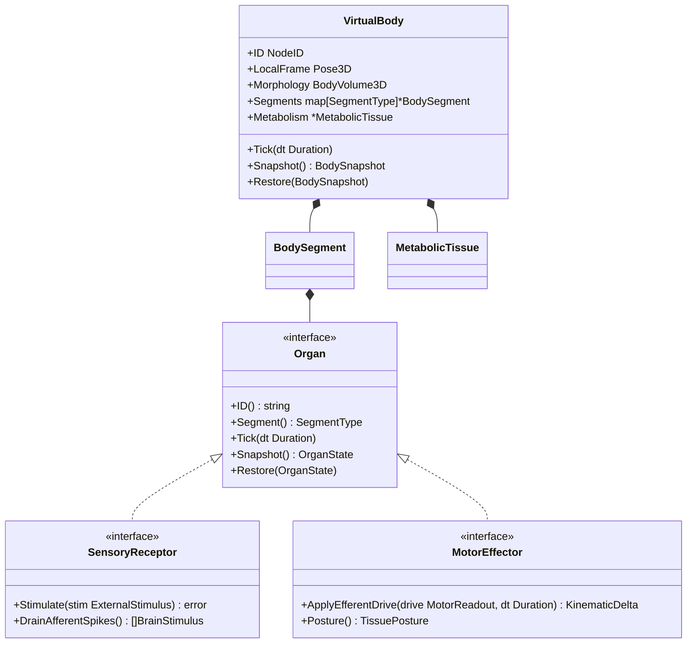
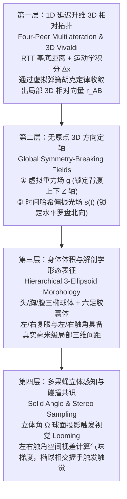
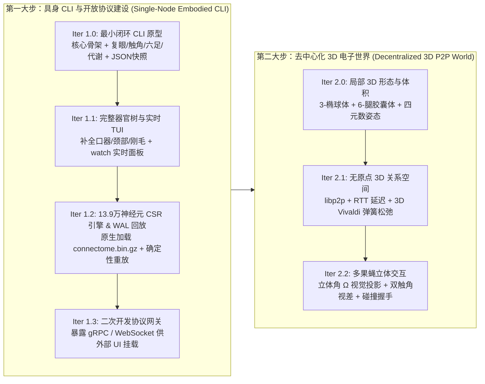

# Go 语言果蝇虚拟身体（`flybody`）与无原点三维去中心化空间架构设计
# Go Virtual Body (`flybody`) & Origin-Free 3D Decentralized Digital World Architecture

> 记录日期：2026-11-04  
> 本文档是继《源码精读学习计划》与《数字灵魂（FlySoul）工程架构》之后的**下一阶段工程演进蓝图**。  
> 核心目标：使用 **Go 语言**为 13.9 万神经元果蝇大脑打造一个脱离 2D 浏览器画布束缚的**命令行虚拟身体（Virtual Body）**，并构建一套**无全局中心原点 $(0,0,0)$ 的三维去中心化果蝇电子世界（Decentralized 3D Relational Space）**。

---

## 一、 核心设计哲学与语言选型

### 1. 遵循的四大工程原则
1. **编码如派活（Assigning Tasks）**：外部调用者（CLI 或 P2P 网络）不直接操作脑区神经电流，而是向承担主责的器官结构体（如复眼 `CompoundEye`、触角 `Antenna`）下达物理刺激任务，由器官内部完成信号转导并向大脑汇报。
2. **编码如写故事（Story-driven Orchestration）**：每个生理节拍（Tick）的代码按“感官采集 $\rightarrow$ 神经突触传播 $\rightarrow$ 效应器运动做功 $\rightarrow$ 代谢能量结算”的自然叙事顺序编排。
3. **建对象即定边界（Responsibility Boundary）**：每个 `struct` 严格归属于领域层（Domain）、应用编排层（Application）或基础设施层（Infrastructure）。
4. **RSI 相似性抽象（Abstracting Similarities）**：识别复眼、触角、口器、六足、双翅、脂肪体之间的解剖与生理共性，抽象出统一的 `Organ`（器官生命周期）、`SensoryReceptor`（传入感受器）与 `MotorEffector`（传出效应器）接口。

### 2. 为什么选择 Go 语言？
* **并发模型天然契合“器官自治 + 神经纤维管道”**：每个器官拥有独立的生理适应与疲劳恢复节律，Go 的轻量级 `goroutine` 与类型安全的 `channel`（如 `chan AfferentSpike`、`chan EfferentDrive`）能直观映射传入/传出神经通路。
* **隐式接口与显式结构体组合**：最适合践行“职责边界划分”与 RSI 器官共性抽象，避免过度继承带来的层级腐化。
* **去中心化与协议生态的绝对统治力**：P2P 网络事实标准库 **`libp2p` 原生主语言即为 Go**；同时原生支持 gRPC、WebSocket、Unix Domain Socket 以及强大的终端 TUI 生态（`cobra` + `bubbletea`）。
* **计算性能充裕**：139,255 个神经元、约 370 万条突触边的 CSR 稀疏矩阵乘法，在纯 Go 中单次 Tick 耗时仅 **~0.8–1.5ms**，无需依赖外部 C++ 引擎即可实现全脑 + 全身实时闭环。

---

## 二、 虚拟身体（`VirtualBody`）领域建模与分层架构

虚拟身体在程序上是一个**由三大体节（头 `Head`、胸 `Thorax`、腹 `Abdomen`）挂载多个生理器官与代谢组织构成的组合体**。



### 1. 领域层（`internal/domain/...`）—— 器官职责与信号转导

| 体节 (`Segment`) | 器官/组织结构体 (`struct`) | 实现接口 | 传入职责 (`External -> Brain`) | 传出职责 (`Brain -> Body`) | 内部维护状态 |
| :--- | :--- | :--- | :--- | :--- | :--- |
| **头部 (`Head`)** | `CompoundEye` (左右复眼) | `Organ`, `SensoryReceptor` | 将外部波长/RGB颜色、光强、迫近立体角 $\Omega$ 分解为明暗通道 (`VIS_LA`)、色度拮抗通道 (`VIS_ME`) 与迫近通道 (`VIS_LO`) | — | 光感受器适应阈值 (`adaptation`)、小眼网格激活图 |
| **头部 (`Head`)** | `Antenna` (左右触角 & 江氏器) | `Organ`, `SensoryReceptor` | 将气味分子浓度转导为 `OLF_ORN_FOOD` / `OLF_ORN_DANGER`；将气流、重力与求偶歌振动转导为 `MECH_JO`；将温度转导为 `THERMO_WARM/COOL` | — | 嗅觉受体饱和度、触角偏转角 |
| **头部 (`Head`)** | `Proboscis` (口器与味觉毛) | `Organ`, `SensoryReceptor`, `MotorEffector` | 接触食物时转导甜/苦味 (`GUS_GRN_SWEET` / `BITTER`) | 响应 `MN_PROBOSCIS` 与 `SEZ_FEED` 伸展喙部吸食，向代谢系统补充糖分 | 喙伸展度 (`extension` $0\sim 1$)、吸食速率 |
| **头部 (`Head`)** | `NeckJoint` (颈部肌群) | `Organ`, `MotorEffector` | — | 响应 `MN_HEAD` 控制头部偏航/俯仰偏转角 | 头部相对胸腔旋转四元数 |
| **胸部 (`Thorax`)** | `ThoracicLeg` (六足 `L1..R3`) | `Organ`, `SensoryReceptor`, `MotorEffector` | 足端接触力与地形反馈转导为 `MECH_TOUCH` / `MECH_BRISTLE` | 响应 `MN_LEG_L1..R3` 推进三足步态相位、产生抓地力或前肢理毛动作 | 髋/股/胫关节角、步态相位 (`phase`)、地面接触态 |
| **胸部 (`Thorax`)** | `WingPair` (左右双翅) | `Organ`, `MotorEffector` | — | 响应 `MN_WING_L/R` 双侧拍翅产生升力/推力，或单侧振翅发射求偶歌声波 | 展翅角 (`spread`)、拍翅频率 (`Hz`) |
| **腹部 (`Abdomen`)**| `MetabolicTissue` (肠道与脂肪体) | `Organ` | 将低血糖、高乳酸、体表脏污转化为内驱力脉冲 (`DRIVE_HUNGER`, `DRIVE_FATIGUE`, `DRIVE_GROOM`) | 结算全身肌肉做功耗能与进食补给 | 血淋巴糖储量 (`glycogen`)、ATP/乳酸疲劳值、体表清洁度 |

#### 示例：复眼接收颜色与视觉信息的职责封装
当通过 CLI 向左复眼注入紫外/蓝紫光时，外部调用者只需把 `LightStimulus` 交给 `CompoundEye`：
```go
type LightStimulus struct {
    WavelengthNM float32   // 波长 (如 350nm UV, 450nm Blue, 520nm Green) 或 RGB
    IntensityLux float32   // 光照强度 [0.0, 1.0]
    DirectionLocal Vec3    // 局部入射方向向量 (用于计算激活的小眼区域与立体角)
    SolidAngleSR float32   // 目标占据的立体角 (球面度, 用于检测 Looming 迫近)
}

// PerceiveLight 由复眼自身承担光电转换职责
func (e *CompoundEye) PerceiveLight(stim LightStimulus) {
    // 1. 依据果蝇 R1-R6 (宽谱明度) 与 R7/R8 (UV/蓝/绿颜色拮抗) 生理特性计算通道电流
    // 2. 结合当前光适应状态 e.adaptation 进行非线性压缩 (韦伯-费希纳定律)
    // 3. 若 d(SolidAngleSR)/dt 超过迫近阈值，额外激发 VIS_LO (LPLC2 逃生通路)
    // 4. 缓存至待发送神经冲动队列
}
```

---

### 2. 应用编排层（`internal/app/runtime`）—— 生命节拍的故事线

```go
func (rt *BodyRuntime) Step(dt time.Duration) {
    // 第一幕：全身感觉器官完成生理适应，汇总传入神经脉冲 (Afferent)
    afferentSpikes := rt.body.CollectAfferentSpikes(dt)

    // 第二幕：代谢系统汇报当前内驱力 (Hunger, Fear, Fatigue, Groom, Curiosity)
    drives := rt.body.Metabolism().CurrentDrives()

    // 第三幕：果蝇大脑推进 CSR 突触传播，输出下行与电机神经元读数 (Efferent)
    motorReadout := rt.brain.Step(afferentSpikes, drives, dt)

    // 第四幕：六足、双翅、口器、颈部响应电机指令，更新组织姿态并产出运动学增量
    kinematics := rt.body.ActuateEffectors(motorReadout, dt)

    // 第五幕：代谢组织结算本次运动耗能与进食摄入，空间模块更新局部相对位移
    rt.body.Metabolism().Settle(kinematics, dt)
    rt.space.IntegrateLocalMotion(kinematics, dt)
}
```

---

## 三、 命令行交互（CLI）、持久化与二次开发协议设计

系统采用 **`flyd`（后台常驻守护进程） + `flyctl`（命令行控制与观测客户端）** 架构。

### 1. 命令行能力设计（`flyctl`）
* **向指定器官注入刺激**：
  ```bash
  # 向左复眼输入波长 365nm (紫外光)、强度 0.8、左前方 30° 的视觉信号
  flyctl stim eye --side=left --wavelength=365 --intensity=0.8 --azimuth=30 --elevation=10

  # 向左复眼输入 RGB 颜色与快速迫近的物体体积 (立体角从 0.05 膨胀到 0.6)
  flyctl stim eye --side=both --rgb="#FF4500" --looming-rate=0.55

  # 向触角输入食物气味（右触角浓度高于左触角，诱导右转）
  flyctl stim antenna --odor=food --left=0.35 --right=0.75

  # 机械触碰右侧前腿 (L_R1)
  flyctl stim touch --segment=thorax --organ=leg_r1 --force=0.6
  ```
* **查看虚拟身体各组织的行为与状态变动**：
  ```bash
  # 单次查看全身器官状态树 (支持 --format=table|json|yaml)
  flyctl inspect body

  # 开启终端实时生理与行为监控面板 (基于 bubbletea TUI)
  flyctl inspect --watch
  ```
  *`flyctl inspect --watch` 输出效果示意*：
  ```text
  [FlyNode: peer-8f3a] Tick: #14,280 | Behavior: WALK_APPROACH | ATP/Glycogen: 78.4%
  ├── HEAD (Pitch: +4.2°, Yaw: +18.5°)
  │   ├── Eye.Left   : Adapt=0.22 | R1-R6(Lum)=0.74 | R7/R8(Color)=UV-Dom | Looming=0.02
  │   ├── Eye.Right  : Adapt=0.21 | R1-R6(Lum)=0.81 | R7/R8(Color)=UV-Dom | Looming=0.02
  │   ├── Antenna.L/R: FoodOdor=[L:0.35, R:0.75] (Δ=+0.40 -> Right Bias) | JO_Vib=0.05
  │   └── Proboscis  : State=RETRACTED (Ext=0.00) | SweetGRN=0.00
  ├── THORAX (Speed: 1.42 mm/s, TripodGaitPhase: 214°)
  │   ├── Tripod.A (L1, R2, L3): STANCE (PushForce=0.64, CoxaAngle=+22°)
  │   ├── Tripod.B (R1, L2, R3): SWING  (LiftHeight=0.35mm, CoxaAngle=-18°)
  │   └── Wings (L/R)          : FOLDED (Spread=0.00, Freq=0Hz)
  └── ABDOMEN
      └── Metabolism           : Hunger=0.42 | Fatigue=0.19 | Fear=0.04 | GroomUrge=0.11
  ```

### 2. 状态持久化架构（Persistence：`.flysoul` 单文件容器）
为了完整保存虚拟身体与大脑的瞬时生命状态，采用 **SQLite 单文件容器（或 BoltDB）+ Protobuf 快照 + WAL 事件日志** 方案：
1. **器官状态树与全脑膜电位快照（`body_snapshots` 表）**：
   * 每个 `Organ` 实现 `Snapshot() OrganState` 与 `Restore(OrganState)`。
   * 序列化内容包括：各器官生理参数（适应度、关节角、步态相位）、代谢系统储量、以及大脑 `139,255` 个 `float32` 神经元膜电位 `V[]`（原始大小 `557 KB`，`zstd` 压缩后约 `120 KB`）。
   * 支持随时执行 `flyctl snapshot save ./my_fly.flysoul` 与 `flyd --restore ./my_fly.flysoul`，实现数字生命的**跨机器冷迁移与休眠唤醒**。
2. **因果刺激与行为预写日志（`stimulus_wal` 表）**：
   * 按逻辑时钟 `TickID` 记录每一次外部注入的 `ExternalStimulus` 与关键行为状态跃迁。
   * 支持确定性回放：`flyctl replay ./my_fly.flysoul --from-tick=10000 --speed=0.5x`，方便开发者慢放观察某次视觉或触觉刺激在全身组织间引发的连锁反应。

### 3. 开放协议接入能力（赋能 UI 与二次开发）
`flyd` 内置多协议网关，确保任何外部 UI（Web Canvas、Three.js、Unity、Godot）都能零侵入挂载为虚拟身体的“渲染皮肤”：
* **gRPC (`proto/flybody/v1/body.proto`)**：提供强类型的 `StimulateOrgan`、`GetBodyState` 与双向流 `StreamBodyFrames`（60fps 推送全身骨骼关节旋转四元数与脑区激活度）。
* **WebSocket + JSON-RPC (`/v1/ws`)**：完全兼容现有浏览器前端与 AI Caretaker Agent，可直接替代现有的前端内嵌物理层。
* **Unix Domain Socket (`/tmp/flyd.sock`)**：供本地 `flyctl` 命令行工具以微秒级延迟交互。

---

## 四、 核心创新：如何构建“无中心原点的三维去中心化果蝇电子世界”？

### 1. 核心命题与挑战
在去中心化 P2P 网络中，每只果蝇都是独立运行的 `flyd` 节点，**不存在中心服务器，也不存在全局绝对坐标原点 $(0,0,0)$**。
* 如果仅用两节点间的通信延迟 $\text{RTT}_{AB}$ 乘以系数计算距离 $d_{AB} = \alpha \cdot \text{RTT}_{AB}$，得到的只是一个 **1 维标量（球面距离）**。
* **核心问题**：如何在没有全局原点的前提下，为每只果蝇赋予真实的 **3 维空间位置关系、3 维朝向姿态（Orientation）以及 3 维身体体积（Volume）**，并支持多果蝇交互？

---

### 2. 四层构建方案（Relational 3D Space Architecture）

我们借鉴物理学中的**莱布尼茨关系空间观（Relational Space）**与分布式系统中的 **Vivaldi 网络坐标算法**，通过以下四层机制从 1 维通信延迟升维出完整的 3 维立体世界：



---

#### 第一层：从 1D 延迟到 3D 相对向量 —— 去中心化三维弹簧松弛（3D Vivaldi + 运动学积分）

虽然两节点之间的通信延迟 $d_{AB}$ 是 1 维标量，但几何学中的**多边测量定理（Multilateration）**告诉我们：
* 1 个邻居的距离确定一个球面（1D）；
* 2 个邻居的距离确定一个平面三角形（2D）；
* **只要局部网络中存在 $\ge 4$ 个不共面的邻居节点，仅凭两两之间的 1D 标量距离矩阵 $D = [d_{ij}]$，这群节点在三维空间中的相对几何拓扑（距离与三维夹角）就被唯一锁定了！**

**工程实现（混合网络延迟与躯体运动学）**：
1. **双源距离合成**：果蝇 A 与果蝇 B 之间的物理距离 $L_{AB}$ 由**“网络拓扑基底距离”**与**“身体自主运动位移”**共同决定：
   $$L_{AB}(t) = \max\left(d_{\min},\; \alpha \cdot \overline{\text{RTT}}_{AB} + \left\|\int_0^t (\vec{v}_{B,\text{motor}} - \vec{v}_{A,\text{motor}})\,d\tau\right\|\right)$$
   * $\alpha \cdot \overline{\text{RTT}}_{AB}$：经过指数移动平均平滑的通信延迟距离（代表两节点在数字世界中的天然拓扑远近）；
   * $\int \vec{v}_{\text{motor}}\,d\tau$：果蝇大脑驱动六足行走或双翅飞行累积的三维位移向量（允许果蝇靠拍翅飞行跨越网络延迟的距离，主动靠近远方的同伴！）。
2. **局部浮动向量与胡克定律收敛（3D Vivaldi Relaxation）**：
   * 每个节点维护一个局部浮动三维向量 $\vec{p}_i \in \mathbb{R}^3$（**注意：$\vec{p}_i$ 没有绝对原点意义，所有节点整体平移任意向量 $\vec{c}$，相对向量 $\vec{r}_{AB} = \vec{p}_B - \vec{p}_A$ 保持绝对不变，满足规范不变性 Gauge Invariance**）。
   * 每当节点 A 与邻居 B 交换 Gossip 心跳包时，计算当前预测距离 $\|\vec{p}_B - \vec{p}_A\|$ 与目标距离 $L_{AB}$ 的误差，施加**三维虚拟弹簧力**：
     $$\vec{F}_{AB} = \left(\|\vec{p}_B - \vec{p}_A\| - L_{AB}\right) \cdot \hat{u}_{AB}, \quad \hat{u}_{AB} = \frac{\vec{p}_B - \vec{p}_A}{\|\vec{p}_B - \vec{p}_A\|}$$
   * 节点 A 沿合力方向微调 $\vec{p}_A \leftarrow \vec{p}_A + \eta \sum_{B \in \mathcal{N}(A)} \vec{F}_{AB}$。仅需数次心跳，全网节点即在无中心服务器的情况下自发涌现出稳定的三维相对位移向量 $\vec{r}_{AB}$！

---

#### 第二层：无原点的三维方向对齐 —— 全局对称破缺场（Gravity & Skylight Compass）

有了三维相对位移向量 $\vec{r}_{AB}$，果蝇 A 如何知道果蝇 B 是在自己的“头顶上方”还是“左侧前方”？两只果蝇各自的局部坐标系如何对齐旋转轴？

在真实自然界中，地球上的果蝇也没有 GPS 原点，但它们共享两个**不需要原点的全局方向场（Directional Fields）**：
1. **虚拟重力场 $\vec{g} = (0, 0, -1)$ —— 对齐背腹轴（Dorsal-Ventral / Roll & Pitch）**：
   * 协议定义单位向量 $\vec{g}$ 为重力方向。每只果蝇的虚拟江氏器（`MECH_JO`）与腿部本体感觉时刻感知 $\vec{g}$，使果蝇站立或飞行时天然保持背部朝上（$+Z$）、腹部朝下（$-Z$）。
2. **基于时间哈希的“虚拟天空偏振光场” $\vec{s}(t)$ —— 对齐水平方位角（Azimuth / Heading）**：
   * 真实果蝇通过复眼背缘区（DRA）感知太阳偏振光，校准中央复合体 `CX_EPG` 指南针。
   * 在去中心化电子世界中，所有节点根据当前 UTC 时间戳（或共识纪元 Epoch）计算同一个确定性单位向量 $\vec{s}(t) = (\cos\omega t, \sin\omega t, \sin\phi)$ 作为“虚拟太阳/偏振光轴”。
   * **效果**：无需坐标原点，每只果蝇的 **3D 姿态旋转四元数 $q_i \in SO(3)$**（Yaw 偏航、Pitch 俯仰、Roll 翻滚）都在同一个方向基准下具有明确的几何意义！
   * 当果蝇 A 收到果蝇 B 的状态包 $(q_B, \vec{r}_{AB})$ 时，只需一次四元数逆变换：
     $$\vec{r}_{B \text{ in } A} = q_A^{-1} \odot \vec{r}_{AB} \odot q_A$$
     就能立即得出果蝇 B 在果蝇 A **自身身体坐标系（前 $+X$、左 $+Y$、背 $+Z$）**下的精确三维球坐标（距离 $\rho$、水平方位角 $\theta$、垂直仰角 $\phi$）！

---

#### 第三层：果蝇身体的三维体积与形态学建模（3-Ellipsoid + 6-Capsule Morphology）

在以果蝇自身胸腔中心为 $(0,0,0)_{\text{body}}$ 的局部三维坐标系中，虚拟身体不再是一个零体积质点，而是由**毫米级解剖尺寸的层级几何体**构成（成虫体长约 $2.5\sim 3.0\text{mm}$）：

| 解剖结构 | 几何原语 (Primitive) | 局部中心坐标 $(x, y, z)\text{ mm}$ | 体积尺寸 / 半轴 $(a, b, c)\text{ mm}$ | 挂载的感觉/效应器官空间锚点 |
| :--- | :--- | :---: | :---: | :--- |
| **外层粗包围球** | `Sphere` (Broad-phase) | $(0, 0, 0)$ | 半径 $R = 1.6\text{ mm}$ | 用于快速剔除远距离无关节点的碰撞计算 |
| **头部 (`Head`)** | `Ellipsoid` (椭球体) | $(+0.95, 0.0, +0.15)$ | $(0.35, 0.45, 0.35)$ | • **左复眼半球**：$(+1.05, +0.32, +0.20)$，法向朝左前上<br>• **右复眼半球**：$(+1.05, -0.32, +0.20)$，法向朝右前上<br>• **左/右触角**：$(+1.25, \pm 0.14, +0.10)$<br>• **口器喙端**：$(+1.15, 0.0, -0.20 - L_{\text{ext}})$ |
| **胸部 (`Thorax`)** | `Ellipsoid` (椭球体) | $(0.0, 0.0, 0.0)$ | $(0.65, 0.55, 0.55)$ | • **左/右翅平面**：背侧 $(0.0, \pm 0.45, +0.40)$<br>• **六足基节锚点**：腹侧 $(+0.4/0/-0.4, \pm 0.35, -0.45)$ |
| **腹部 (`Abdomen`)**| `Ellipsoid` (椭球体) | $(-1.15, 0.0, -0.10)$ | $(0.85, 0.55, 0.55)$ | • 分布体表机械刚毛感受器 (`MECH_BRISTLE`) |
| **六足 (`Legs L1..R3`)**| `Capsule` (3段铰接胶囊) | 随步态相位动态解算 | 胶囊半径 $r = 0.06\text{ mm}$ | • 跗节末端（Tarsus）携带接触与味觉感受器 |

---

#### 第四层：多虚拟身体的立体感知与碰撞交互

当两只（或多只）果蝇在去中心化三维空间中靠近时，上述**方位（Orientation）**与**体积（Volume）**直接转化为大脑的真实感官刺激：

1. **视觉体积投影与立体角迫近检测（Solid Angle & Looming）**：
   * 果蝇 A 将邻居果蝇 B 的三个椭球体（头/胸/腹，各自带有体表颜色与求偶展翅姿态）投影到自身左右复眼的球面视野上。
   * 果蝇 B 在果蝇 A 视网膜上占据的**立体角（Solid Angle）**为：
     $$\Omega_{B \to A} \approx \frac{A_{\text{projected}}(q_A, q_B, \text{Volume}_B)}{\|\vec{r}_{AB}\|^2}$$
   * 当 B 快速冲向 A 时，$\|\vec{r}_{AB}\|$ 减小导致立体角膨胀率 $\frac{d\Omega}{dt}$ 激增，左/右复眼根据入射角 $(\theta, \phi)$ 自动激活对应侧的小叶板迫近神经元 `VIS_LO` (`LPLC2`) $\rightarrow$ 诱导果蝇 A 向背离 B 的三维方向起跳逃逸！
   * 当 B 体积较小且处于侧前方移动时，激活小目标追逐神经元 `LC10a` $\rightarrow$ 诱导果蝇 A 转向跟踪。

2. **双侧器官空间视差（Binaural / Bilateral Stereo Sampling）**：
   * 因为左触角 $(+1.25, +0.14, +0.10)$ 与右触角 $(+1.25, -0.14, +0.10)$ 在局部三维空间中相距 $0.28\text{ mm}$，当外部存在气味源或同伴果蝇 B 释放信息素/求偶歌时，信号到达左右触角的局部距离存在微差 $\Delta d = \|\vec{x}_{\text{source}} - \vec{x}_{\text{ant},L}\| - \|\vec{x}_{\text{source}} - \vec{x}_{\text{ant},R}\|$。
   * `Antenna` 结构体据此算出左右两侧的强度差 $(I_L, I_R)$，天然形成三维空间中的左右转向偏置信号。

3. **去中心化体积碰撞协商（P2P Contact Handshake）**：
   * 当两只果蝇的粗包围球距离 $\|\vec{r}_{AB}\| \le R_A + R_B$（即 $\le 3.2\text{ mm}$）时，双方节点自动升级为高频接触握手模式。
   * 双方在各自局部坐标系下对 **3-椭球体 + 6-腿胶囊体** 执行窄相碰撞检测（Narrow-phase GJK/EPA 算法）：
     * 若果蝇 B 的右前腿胶囊体 (`leg_r1`) 与果蝇 A 的腹部椭球体 (`abdomen`) 发生几何相交，穿透深度为 $\delta$；
     * 果蝇 A 的腹部自动产生 `MECH_TOUCH (segment: abdomen, force: k*δ)` 传入大脑；
     * 果蝇 B 的右前腿自动产生 `MECH_TOUCH (segment: leg_r1, force: k*δ)` 传入大脑；
     * 双方同时沿接触法线方向叠加反向排斥位移 $\pm \frac{1}{2}\delta \vec{n}$，保证在无中心物理服务器的情况下，两只虚拟果蝇的身体体积绝不互相穿模！

---

## 五、 工程实施规划：两大阶段与可迭代 CLI 原型（Roadmap）

整体工程拆解为 **两大核心阶段（先单机具身 CLI，后 P2P 三维电子世界）**；而在第一阶段中，优先打通一个**架构边界严密、可持续演进的最小闭环 CLI 原型（Iteration 1.0）**。



### 1. 推荐目录结构（`flybody/`）

```text
flybody/
├── cmd/
│   ├── flybody/               # Iter 1.0 统一 CLI & REPL 入口 (后续演进为 flyd 守护进程 + flyctl 客户端)
│   ├── flyd/                  # 虚拟身体守护进程 (含脑引擎 + P2P 节点 + gRPC/WS 网关)
│   └── flyctl/                # 命令行交互与实时观测工具 (CLI & Bubbletea TUI)
├── api/
│   └── proto/flybody/v1/      # gRPC / Protobuf 协议定义 (供 UI 二次开发与 P2P 通信)
├── internal/
│   ├── domain/                # 【领域层】纯业务逻辑，零 I/O 依赖
│   │   ├── body/              # VirtualBody 聚合根、三大体节 (Head/Thorax/Abdomen)、3D 椭球体积形态
│   │   ├── organ/             # Organ/Receptor/Effector 接口与复眼、触角、口器、六足、双翅实现
│   │   ├── metabolism/        # 代谢组织 (血糖、ATP、内驱力演化)
│   │   ├── brain/             # BrainPort 接口：内置 59 脑区概念连接组 (Iter 1.0) 与 13.9 万 CSR 引擎 (Iter 1.2)
│   │   └── space3d/           # 无原点 3D 关系空间：四元数姿态、Vivaldi 弹簧松弛、立体角与碰撞解算
│   ├── app/                   # 【应用层】故事线编排
│   │   └── runtime/           # 生理节拍器 (Sense -> Propagate -> Actuate -> Settle)、快照与回放编排
│   └── infra/                 # 【基础设施层】外部技术适配
│       ├── store/             # .flysoul 状态快照 (JSON / SQLite) 与 WAL 事件溯源持久化
│       ├── cli/               # 命令行参数解析、状态对比格式化输出与交互式 REPL
│       ├── p2p/               # 基于 libp2p 的节点发现、RTT 测量与 3D 空间 Gossip 同步
│       └── server/            # gRPC、WebSocket 与 Unix Socket 服务端实现
└── go.mod
```

### 2. 第一大步起点：可迭代 CLI 原型（Iteration 1.0）详细规格

为确保原型具备高可迭代性，Iter 1.0 严格确立 **三层架构职责边界** 与 **RSI 器官接口抽象**，后续迭代仅需挂载新器官或替换接口实现，无需推翻重构：

| 所属层级 | 包路径 (`flybody/internal/...`) | 核心对象 (`struct` / `interface`) | 承担的唯一职责（编码如派活） |
| :--- | :--- | :--- | :--- |
| **领域层 (Domain)** | `domain/organ` | `Organ`, `Receptor`, `Effector` (接口) | **RSI 相似性抽象**：统一定义所有器官的生命周期 `Tick(dt)`、快照导出 `Snapshot()/Restore()`、传入脉冲采集与传出动力响应。 |
| **领域层 (Domain)** | `domain/body` | `VirtualBody`, `BodySegment` | **虚拟身体聚合根**：按头/胸/腹管理器官组合，向内收集全身传入脉冲，向外分发大脑运动指令，汇总全身状态树。 |
| **领域层 (Domain)** | `domain/organ/*` | `CompoundEye`, `Antenna`, `HexapodLegs`, `WingPair`, `Proboscis`, `Metabolism` | **首批代表性器官**：<br>• `CompoundEye`：接收颜色(波长/RGB)+光强+迫近率 $\rightarrow$ 转导为 `VIS_LA`/`VIS_ME`/`VIS_LO`<br>• `Antenna`：接收气味/风力 $\rightarrow$ 转导为 `OLF_ORN_*`/`MECH_JO`<br>• `HexapodLegs` & `WingPair`：消化 `MN_LEG_*`/`MN_WING_*` $\rightarrow$ 更新步态相位、速度、展翅频率<br>• `Proboscis` & `Metabolism`：消化 `MN_PROBOSCIS` 与运动做功 $\rightarrow$ 维护血糖、疲劳与 5 大内驱力 |
| **领域层 (Domain)** | `domain/brain` | `BrainPort` (接口), `ConceptConnectome` | **大脑端口边界**：Iter 1.0 先内置 **59 脑区概念连接组引擎**（移植自 [`js/constants.js`](../js/constants.js) & [`js/connectome.js`](../js/connectome.js)，零外部文件依赖、毫秒级启动、逻辑 100% 透明）；Iter 1.2 只需新增 `CSRConnectome` 实现同一接口即可无缝切换至 13.9 万神经元。 |
| **应用层 (Application)** | `app/runtime` | `PhysiologyRuntime` | **像写故事一样编排单步或连续节拍**：<br>`Sense()` $\rightarrow$ `Brain.Propagate()` $\rightarrow$ `Body.Actuate()` $\rightarrow$ `Metabolism.Settle()` $\rightarrow$ `Store.Save()`。 |
| **基础设施层 (Infra)** | `infra/store` | `SnapshotStore` | **状态持久化**：Iter 1.0 提供高可读性的 `.flysoul.json` 状态树快照（含全身器官状态 + 脑电位 + 逻辑时钟 `TickID`），每次刺激或推进节拍支持自动/手动落盘。 |
| **基础设施层 (Infra)** | `infra/cli` | `CLIApp` (`cmd/flybody`) | **命令行交互与协议预留**：解析用户指令，调用 `PhysiologyRuntime` 并格式化输出刺激前后的全身组织状态变动。 |

#### Iter 1.0 核心 CLI 交互命令
```bash
# 1. 查看虚拟身体三大体节、各器官生理参数、活跃脑区与内驱力全貌
flybody inspect

# 2. 向指定器官注入刺激并推进节拍（自动对比刺激前后的组织行为变动）
flybody stim eye --side=left --color="#8A2BE2" --wavelength=365 --intensity=0.8 --ticks=5
flybody stim antenna --odor=food --intensity=0.9 --ticks=5

# 3. 推进自然生命节拍或进入交互式沙盒 REPL
flybody step --ticks=10
flybody repl

# 4. 导出或恢复虚拟身体状态快照
flybody snapshot save ./hungry_fly.json
flybody snapshot load ./hungry_fly.json
```

### 3. 后续迭代演进清单
* **First Major Stage（具身 CLI 与开放协议建设）**：
  * **Iter 1.0**：打通上述最小闭环 CLI 原型与单元测试；
  * **Iter 1.1**：补全颈部关节、体表刚毛等细分组织，接入 `bubbletea` 实现 `flybody inspect --watch` 实时动态终端仪表盘；
  * **Iter 1.2**：实现 `CSRConnectome` 原生加载 `data/connectome.bin.gz`（13.9 万神经元），并升级 `.flysoul` 为 SQLite 快照 + WAL 确定性回放；
  * **Iter 1.3**：守护进程化（`flyd`），暴露 gRPC 与 WebSocket 网关，支持将现有浏览器 UI 或 3D 渲染引擎作为外部皮肤挂载。
* **Second Major Stage（去中心化 3D 电子世界建设）**：
  * **Iter 2.0**：实现 `domain/space3d` 局部三维形态（头/胸/腹 3-椭球体 + 6-腿胶囊体）与四元数姿态解算；
  * **Iter 2.1**：接入 `libp2p` 实现无中心原点的“RTT 通信延迟 + 运动学积分”三维 Vivaldi 弹簧松弛定位，以及虚拟重力场 $\vec{g}$ / 时间偏振光场 $\vec{s}(t)$ 方向定轴；
  * **Iter 2.2**：打通多果蝇节点间的立体角 $\Omega$ 迫近视觉投影、双触角空间视差采样与 P2P 椭球碰撞握手。
